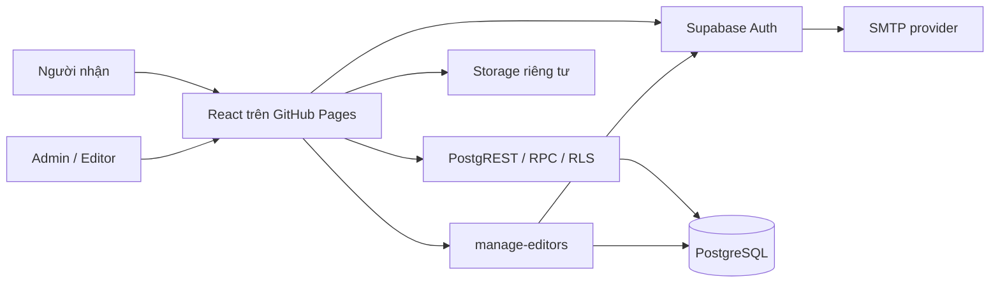

# Vận hành HSV CTUT 3.0.0

Hướng dẫn này mô tả source hiện tại và metadata production đã đọc lại ngày **20/11/2026**. Không sao chép seed hay DDL v1 vào tài liệu; file SQL trong repository là nguồn để review, không phải danh sách lệnh cần chạy lại.

<a id="trang-thai"></a>
## Trạng thái đã đối chiếu

| Thành phần | Bằng chứng | Kết luận |
| --- | --- | --- |
| Source | `main` tại `5d66357`, đã merge v3 | Version package/lock là 3.0.0 |
| CI | [Run 44714222374](https://github.com/imnwngr/hsv/actions/runs/44714222374) | Verify và native accounts PASS; deploy skipped |
| Pages | `/hsv/` còn HTML BookClub và asset base `/bookclub/` trả 404 | Frontend v3 chưa phát hành; gate `HSV_V3_PRODUCTION_READY` chưa đặt |
| Database | Project `trdofhdspbkwgernwybp`, ACTIVE_HEALTHY, PostgreSQL 17.11; metadata/RLS/history qua MCP | Capability version 3, theme version 1, hai loại thiệp và operation ledger có mặt |
| Edge | `manage-editors` ACTIVE, revision 5, `verify_jwt=true` | Revision đã deploy; không suy ra kết quả mời production |
| SMTP | Chủ dự án xác nhận tự cấu hình Resend và nhận email thử | Ghi nhận SMTP đã thiết lập; chuỗi invite/cấp quyền/accept production chưa được kiểm chứng toàn bộ |

Đợt cập nhật tài liệu chỉ đọc metadata, không đọc danh sách Auth hoặc nội dung khách mời; không áp dụng SQL, sửa Auth/SMTP, đổi secrets hoặc gửi thư thử. Cấu hình Auth/Edge environment cần đọc lại trong đợt rollout, không lấy kết quả lịch sử làm cấu hình hiện tại.

## Kiến trúc đang dùng



Frontend không có service-role key. Edge xác minh JWT và quyền Admin trước khi quản lý Editor. CORS production dùng origin `https://imnwngr.github.io`, không kèm `/hsv/`. Storage lấy signed URL sau kiểm tra quyền; không đổi tên bucket chỉ để khớp tên repo.

### Dữ liệu và RPC

Metadata hiện có **10 bảng public, tất cả bật RLS**:

| Bảng | Trách nhiệm |
| --- | --- |
| `events` | Sự kiện, loại thiệp, theme, trạng thái, nội dung rich text, quote, video/nhạc và thông tin địa điểm |
| `guests` | Danh bạ cá nhân/nhóm, alias mặc định, trạng thái và thứ tự |
| `event_guests` | Snapshot người nhận của từng sự kiện, primary alias |
| `invitation_aliases` | Các alias ánh xạ về cùng snapshot |
| `event_agenda_items` | Nội dung chương trình, giờ và icon |
| `admin_users`, `editor_users` | Membership gắn với Supabase Auth |
| `venue_image_uploads`, `music_uploads` | Đăng ký media và vòng đời upload |
| `editor_add_operations` | Lease/trạng thái cho thao tác thêm Editor và khôi phục |

`save_event` lưu qua transaction và kiểm tra `p_expected_updated_at` để từ chối ghi đè dữ liệu đã thay đổi. Frontend đọc sự kiện qua `get_event_v110`, thiệp qua `resolve_invitation`; tên `v110` còn được giữ để tương thích, không có nghĩa payload chỉ hỗ trợ v1.1. Danh bạ dùng `reorder_guests` để kiểm tra thứ tự dự kiến trước khi ghi.

`event_type` chỉ nhận `invitation` hoặc `congratulation`, mặc định `invitation`. `starts_at`/`ends_at` nullable ở schema; CHECK vẫn yêu cầu Thiệp mời có thời gian hữu hạn, kết thúc sau bắt đầu và liên kết địa điểm hợp lệ. Thiệp chúc có thể không có thời gian/địa điểm; dữ liệu trước đó không bị xóa khi đổi loại. Giờ hiển thị 24h theo Việt Nam, lưu bằng `timestamptz`.

`theme` có đúng dạng `{ "version": 1, "primary": "#174b78" }`. SQL và frontend từ chối key thừa/raw CSS. Theme đọc trực tiếp từ sự kiện; salutation, tên, mô tả, cá nhân/nhóm của thiệp đọc từ snapshot. Chỉnh danh bạ không tự cập nhật snapshot cũ.

Draft không được resolver công khai trả về. URL sai loại chỉ được chuyển canonical sau khi resolver có quyền trả dữ liệu; chuyển URL không được dùng để bỏ qua kiểm tra draft. Các slug `admin`, `auth`, `thiep-moi`, `thiep-chuc` được dành riêng.

### Storage

| Bucket | Quyền | Giới hạn một file |
| --- | --- | --- |
| `bookclub-venues` | Private | 5 MiB |
| `bookclub-music` | Private | 20 MiB |

Tên kỹ thuật cũ được giữ nguyên để bảo toàn media. Không đổi bucket, object path hoặc dữ liệu sự kiện thật để xóa nhận diện cũ.

<a id="cau-hinh"></a>
## Cấu hình frontend và Auth

| Biến | Bắt buộc | Nơi dùng |
| --- | --- | --- |
| `VITE_SUPABASE_URL` | Có | `.env.local` / GitHub repository variable |
| `VITE_SUPABASE_PUBLISHABLE_KEY` | Có | Khóa công khai của đúng môi trường, không phải service-role |
| `VITE_GOOGLE_MAPS_API_KEY` | Không | Giới hạn HTTP referrer, API và quota; dù lưu bằng GitHub secret, khóa vẫn vào client bundle |
| `VITE_GOOGLE_MAPS_MAP_ID` | Không | Map ID nếu cấu hình Maps yêu cầu |

URL Google Maps/Place ID nhập thủ công vẫn là phương án sẵn có. `.env.local` không được commit. Chạy `npm run check:backend` khi hai biến Supabase đã có trong process environment; script này không tự nạp `.env.local`. Nó chỉ xác nhận đúng project và capability schema, không kiểm SMTP, backup, RLS hoặc toàn bộ Edge behavior.

Callback production cần phục vụ và có trong Auth allowlist:

```text
https://imnwngr.github.io/hsv/auth/accept
https://imnwngr.github.io/hsv/auth/callback
```

Trong audit backend trước rename, cả callback `/bookclub/` và `/hsv/` đã có; Site URL còn `/bookclub/`. Khi rollout, đối chiếu cấu hình mới nhất, đổi Site URL theo frontend đang phục vụ và chỉ giữ callback cũ nếu còn hosting xử lý được. Có URL trong allowlist không làm một trang 404 hoạt động. Môi trường local/staging cần URL riêng được phép dùng; không dùng fixture để thay dữ liệu thật.

Edge ở chế độ `live` chỉ chấp nhận origin Pages. Nối Vite local vào project production không làm luồng thêm Editor chạy được từ localhost: request sẽ bị CORS/origin từ chối. Kiểm thử luồng này bằng sandbox tài khoản có `HSV_LOCAL_ORIGIN` trỏ tới cổng frontend local; không nới CORS production để thử giao diện.

### Thêm Editor và xử lý lỗi một phần

Admin gửi action `add`, email, role `editor` và `request_id`; giao diện không yêu cầu chọn invite/grant. Server đọc capability gửi lời mời và kiểm tra quyền tại mỗi thao tác. Action `grant` cũ giữ tương thích với tài khoản có sẵn; action `invite` cũ yêu cầu nâng client.

`begin_editor_add` và `finish_editor_add` chỉ service role được EXECUTE; client không có quyền đọc/ghi ledger trực tiếp. `editor_add_recovery` kiểm tra Admin ở server. Metadata ngày 20/11 xác nhận authenticated không đọc được ledger hoặc EXECUTE begin. Revoke vô hiệu hóa thao tác đang chờ; retry yêu cầu đã revoke không tự cấp lại.

Auth invite và SQL cấp quyền không có transaction chung. Nếu email đã gửi nhưng grant thất bại, dùng khôi phục để cấp quyền cho tài khoản đã tạo; không gửi lại email. Nếu response mất và chưa xác định Auth đã tạo user hay chưa, giữ trạng thái chưa xác định, đối chiếu logs trước khi gửi mới. Không báo hoàn tất chỉ vì một bước đã thành công.

Edge dùng `BOOKCLUB_ROLE_MODE` (`live`, `sandbox`, `fixture`) và `HSV_INVITATIONS_ENABLED` (`disabled` hoặc `verified`). Trong audit trước Resend, live/disabled là trạng thái đã kiểm chứng. Đọc lại cờ hiện tại trong rollout; đừng bật `verified` chỉ vì SMTP test thành công. Sandbox chỉ dùng Supabase loopback/Kong local và mail sink không relay, fixture không gửi thư ra ngoài.

## Migration: đối chiếu history, không replay

History production vừa đọc lại có sáu bản ghi sau. Tên file source và timestamp trên server khác nhau vì migration đã được áp dụng qua management tooling:

| File trong `supabase/migrations/` | Version history |
| --- | --- |
| `202611080001_editor_roles.sql` | `20261106230837` |
| `202611090001_event_description_rich.sql` | `20261106230900` |
| `202611090002_event_youtube.sql` | `20261106230911` |
| `202611100001_background_music.sql` | `20261107000158` |
| `202611200001_event_types_theme.sql` | `20261119220329` |
| `202611200002_editor_add_operations.sql` | `20261119220343` |

Các thay đổi v1/v1.1 còn có lịch sử thực thi thủ công/rebuild; sáu dòng này không phải toàn bộ quá trình tạo schema. **Không chạy `supabase db push` cả thư mục, seed cũ, reset hoặc REBUILD.sql trên production.** Thiếu một tên file trong history không đủ chứng minh SQL chưa được áp dụng. Đối chiếu definitions, constraints, ACL và dữ liệu trước mỗi migration mới.

Trước một thay đổi production mới: xác nhận project/schema, backup và phạm vi phục hồi; thử migration nguyên file trên môi trường tách biệt; review trước/sau và rollback/containment; chỉ áp dụng phần chưa tồn tại; kiểm tra hậu triển khai. Các truy vấn đối chiếu v3 còn ở [preflight](../supabase/hsv-v3-preflight.sql) và [postflight](../supabase/hsv-v3-postflight.sql); review trước khi dùng với trạng thái mới. Giữ RLS và quyền EXECUTE tối thiểu.

Hai migration v3 đã qua restore thử trên PostgreSQL 17.11 với snapshot phần public: 9 bảng trước ledger, 26 hàm và metadata liên quan. Fingerprint dữ liệu cũ và 24 hàm không liên quan giữ nguyên sau apply. Đây là bằng chứng lịch sử có phạm vi, **không phải backup mới hoặc full restore Auth/Storage/SMTP**. Backup/manifest riêng không được commit hay upload lên CI. Muốn thay production tiếp phải kiểm tra lại bản backup còn dùng được và thử phục hồi phù hợp.

<a id="moi-truong-moi"></a>
## Chuẩn bị môi trường mới

Repository hiện **chưa cung cấp một bootstrap v3 cho database trống có thể chạy một lệnh**. Không dùng manual v1 hoặc seed chứa danh bạ cũ làm hướng dẫn tạo project mới.

1. Tạo project tách biệt, xác nhận không có dữ liệu thật.
2. Chuẩn bị baseline hiện tại không destructive dựa trên schema/constraints/RPC đã audit; review Auth, RLS, Storage và grant riêng. Schema v1.1 trong kho chỉ là tài liệu đầu vào, thiếu các thay đổi sau đó.
3. Dùng fixture synthetic, thử cả Thiệp mời và Thiệp chúc, null thời gian, theme, resolver/draft, snapshot và alias. Không sao chép người nhận thật vào seed.
4. Tạo tài khoản qua Auth, bootstrap Admin bằng quy trình operator đã review; không đưa UUID thật hoặc credentials vào repository.
5. Cấu hình Edge/Auth/redirect/SMTP riêng cho môi trường, kiểm tra trước khi nối frontend.

Harness `scripts/test-hsv-native.mjs` dựng sandbox **tài khoản** để kiểm JWT, Auth, Edge, SQL và Mailpit. Baseline synthetic đó không phải bản sao đầy đủ của schema sự kiện production và không thay cho bước dựng môi trường ứng dụng mới.

## Pages và trình tự phát hành

Workflow [deploy.yml](../.github/workflows/deploy.yml) chạy kiểm thử trên push `main`/`hsv-v3` và PR. Deploy chỉ chạy trên `main` tại `imnwngr/hsv`, ngoài pull request, khi `HSV_V3_PRODUCTION_READY=true`; cả verify và native accounts phải thành công. Trước deploy có `check:backend` chỉ đọc. CI PASS với deploy skipped không phải một lần phát hành.

1. Kiểm tra backup/schema/Edge và các điều kiện backend nêu trên; không replay hai migration v3.
2. Đối chiếu Auth Site URL, redirects và SMTP của môi trường. Giữ gửi lời mời chưa mở khi callback frontend chưa phục vụ.
3. Sau khi release gates có bằng chứng phù hợp, operator bật gate Pages và chạy workflow trên `main` đã kiểm thử. Không sửa workflow để bỏ qua gate.
4. Smoke URL thật: home, asset/font, thiệp đúng loại, draft, deep link/refresh, callback và responsive. GitHub Pages có thể trả HTTP 404 ban đầu trên deep link; phải kiểm tra cả khôi phục route trong trình duyệt.
5. Kiểm chứng luồng mời bằng địa chỉ/môi trường kiểm thử được phép, ghi rõ phạm vi. Chỉ mở gửi lời mời theo kết quả đã xác minh; không dùng email ngẫu nhiên hoặc người dùng thật làm fixture.
6. Tạo/publish tag và release khi điều kiện phát hành đã đạt; không ghi đè tag `v3.0.0` nếu đã tồn tại.

Giữ link `/bookclub/` cần hosting bridge riêng rồi resolver xác định loại. Redirect repository GitHub không tạo redirect cho Pages. Lần đối chiếu 20/11: `/bookclub/` 404, `/hsv/` còn HTML cũ; chưa có bridge được kiểm chứng.

### Containment và khôi phục

Nếu rollout frontend lỗi, chặn deploy tiếp và phục hồi artifact frontend tương thích v3 đã xác minh. Không đưa frontend v2 lên schema đã có Thiệp chúc với thời gian null. Nếu cấp quyền/email lỗi, đóng khả năng gửi mới và kiểm tra ledger/logs; giữ tài khoản, ledger và dữ liệu mới để khôi phục.

Giữ các cột/schema mới cùng dữ liệu phát sinh. Không drop bảng, restore snapshot cũ đè dữ liệu mới hoặc reset production. Khi rollback Edge, dùng revision đã lưu và tương thích ledger/v3, không trở lại nhánh invite cũ chỉ vì dễ deploy.

## Bằng chứng và tài liệu lịch sử

Release notes chứa kết quả CI có link đến run. Logs, screenshots, trace, manifests và backup thuộc `.local/` hoặc thư mục bảo vệ ngoài repo. Bốn runner live lịch sử ghi báo cáo vào `.local/legacy-checks/`; chúng có thể ghi fixture lên database nên **không chạy chỉ để đọc trạng thái**.

`npm run test:e2e` giữ đầy đủ test/assertion, ảnh lỗi và trace khi lỗi. Ảnh nghiệm thu hàng loạt của các ma trận redesign, vật liệu/nhạc và HSV v3 chỉ xuất khi chạy `npm run test:e2e:visual` (có thể truyền thêm `-- --project=desktop`). Cả hai lệnh chạy cùng bộ test; chế độ visual chỉ bật `HSV_CAPTURE_VISUALS=1`, không thay retries, timeout hoặc điều kiện deploy.

Các ảnh này là bằng chứng để xem thủ công, không phải phép so sánh ảnh tự động. Giữ kiểm tra overflow, ảnh tải thành công, accessibility, focus, audio, reduced motion, dữ liệu và quyền trong lượt chạy mặc định. Không xóa test hồi quy chỉ vì đã PASS; test mang tên phiên bản cũ vẫn có thể bảo vệ hành vi đang sử dụng.

Đo local ngày 23/11/2026: cùng 9 test `redesign viewport`, desktop Chrome, 2 worker, chạy tuần tự, bật xuất ảnh mất 57,74 giây; mặc định mất 41,69 giây (giảm 27,8%). Cả hai lượt đều PASS 9/9, không retry. Đây là số đo của nhóm ma trận này, không đại diện tốc độ toàn bộ E2E hay CI. Báo cáo ở `.local/readme-review/e2e-{capture,default}-sequential.json`; không chạy hai lượt Playwright cùng lúc trong một checkout vì chúng dùng chung server và thư mục artifact.

Kế hoạch, biên bản nghiệm thu và manual v1/v2 đã hoàn tất được lấy lại từ lịch sử Git khi cần. Chúng không còn là hướng dẫn hiện hành. Bộ SQL [rebuild-v110](../supabase/rebuild-v110/README.md) còn để phục vụ lịch sử và test; không phải công cụ setup/upgrade v3.

Các bản gốc trước dọn dẹp được ghim tại commit `5d663574be5a2357c2b161385d1b4fe0d430a75f`, vẫn thuộc lịch sử `main` khi xóa nhánh `hsv-v3`:

| Nội dung cần đối chiếu | Bản gốc trong lịch sử |
| --- | --- |
| Test matrix v3, logs/screenshots, native email và giới hạn production | [HSV-V3-VERIFICATION.md](https://github.com/imnwngr/hsv/blob/5d663574be5a2357c2b161385d1b4fe0d430a75f/HSV-V3-VERIFICATION.md) |
| Backup/restore có phạm vi, đường dẫn bằng chứng riêng, migration, Auth và containment | [HSV-V3-MIGRATION.md](https://github.com/imnwngr/hsv/blob/5d663574be5a2357c2b161385d1b4fe0d430a75f/HSV-V3-MIGRATION.md) |
| Opening, audio, Liquid Glass, cuộn thuận/ngược và reduced motion | [INVITATION-3.0-VERIFICATION.md](https://github.com/imnwngr/hsv/blob/5d663574be5a2357c2b161385d1b4fe0d430a75f/INVITATION-3.0-VERIFICATION.md), [scroll review](https://github.com/imnwngr/hsv/blob/5d663574be5a2357c2b161385d1b4fe0d430a75f/INVITATION-SCROLL-FIX-VERIFICATION.md) |
| Tất cả kế hoạch, review SQL, manual và nghiệm thu cũ | [Cây source trước dọn dẹp](https://github.com/imnwngr/hsv/tree/5d663574be5a2357c2b161385d1b4fe0d430a75f) |

Các liên kết này giữ nguyên bằng chứng lịch sử, không xác nhận trạng thái production hôm nay. File log/backup riêng không nằm trong Git; đường dẫn được ghi trong biên bản không bảo đảm file còn tồn tại hoặc có thể khôi phục.
