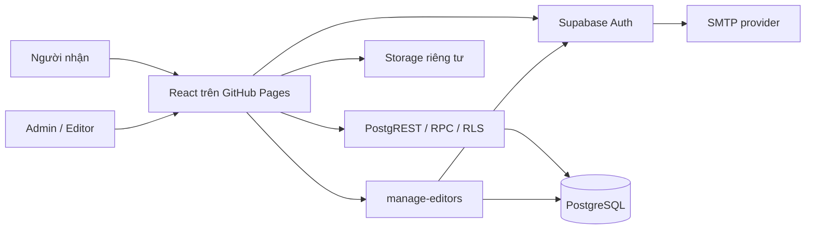

# Vận hành HSV CTUT 3.0.0

Hướng dẫn này mô tả source `main`, đã nhận `hsv4` qua PR #2 tại `0d17ad0`; trạng thái SQL mới nhất được xác minh ngày **23/11/2026**. Nhánh `hsv4` đã xóa sau khi kiểm tra toàn bộ lịch sử nằm trong `main`. Không sao chép seed hay DDL v1 vào tài liệu; các file SQL đã áp dụng không phải danh sách lệnh cần chạy lại khi pull source.

Release lịch sử [v3.0.0](https://github.com/imnwngr/hsv/releases/tag/v3.0.0) đã được tạo tại merge commit `5d663574be5a2357c2b161385d1b4fe0d430a75f` của PR #1, không phải HEAD hiện tại. Release này không chứa HSV4, không chạy SQL hoặc deploy lại v3. Chưa tạo release v4.0.0.

<a id="editor-polish"></a>
## Thu gọn editor và sửa toast — 23/11/2026

Nút đóng toast dùng vùng bấm 44×44 px, SVG 16 px, đặt bên phải trong thông báo; hỗ trợ Enter/focus và thông báo lỗi nhiều dòng. Editor giảm khoảng đệm/cỡ tiêu đề, nhóm các trường ngắn, thu preview màu/ảnh và sắp xếp cấu hình điểm danh. Track grid, nhập giờ và nút sắp xếp cho phép xuống dòng khi phóng chữ. Không đổi payload, dirty state, lưu/hủy, media, snapshot hay SQL.

Source chính: `AdminShell.tsx`, `EventForm.tsx`, `AttendanceEditor.tsx`, `admin.css`, `attendance.css`; hồi quy mới ở `tests/e2e/editor-layout.spec.ts`. Không thêm dependency. Lint, production build gồm typecheck và 172 unit/SQL đạt; lượt browser đầy đủ đạt 227 ca, 43 skip do ma trận chỉ chạy một project. Sau sửa thêm bố cục chữ 200%, lượt tái kiểm editor/nhập giờ/lưu đạt 67 ca, 21 skip; bộ 5 ca chuyên biệt được chạy lại sau chốt khoảng đệm. Log và ảnh nằm tại `.local/editor-polish/` (ignored).

Ảnh `before/`, `after/` và `inspection/` bao phủ 320/390/768/1440 px; axe không ghi nhận vi phạm trong editor/toast được kiểm. Chữ 200% không tràn ngang, lỗi lưu giữ dữ liệu và cho thử lại; nút đóng thao tác được bằng bàn phím. Kiểm thử ghi dùng network mocks. Đây không phải bằng chứng camera/GPS, screen reader hoặc bàn phím ảo trên điện thoại thật.

Theo yêu cầu người dùng, bản sửa được commit/push lên `main`. Workflow sẵn có chạy kiểm thử và deploy Pages khi gate `HSV_V3_PRODUCTION_READY=true`; không sửa workflow hoặc gate. Trạng thái deploy phải đọc từ run tương ứng trên GitHub Actions, không suy ra từ việc push thành công. Các mốc “chưa deploy” dưới đây ghi lại trạng thái tại đợt SQL trước đó.

Run [45106500917](https://github.com/imnwngr/hsv/actions/runs/45106500917) dừng ở test sắp xếp danh bạ trên mobile: thao tác kéo chạm đã lưu, nhưng phím ↑ của lượt kéo tiếp theo không đổi vị trí. Trace ghi nhận placeholder đã xuất hiện trong khi danh sách vẫn cuộn theo phím; `KeyboardSensor` của dnd-kit đăng ký bộ nhận phím bằng timer sau khi bắt đầu kéo. Test nay chờ trạng thái kéo, overlay và một nhịp render/timer trước khi gửi phím tiếp theo. Kiểm tra rollback đợi lưu kết thúc và đối chiếu cả thứ tự giao diện lẫn dữ liệu mock. Không bỏ assertion, thêm retry hoặc tăng timeout; không đổi source ứng dụng, workflow, dependency hay SQL.

Kiểm tra bản sửa: typecheck, lint, production build đạt; 172 unit/SQL đạt với `--maxWorkers=2`; ca sắp xếp đạt 24/24 lượt lặp desktop/mobile; toàn bộ browser suite đạt 228 ca, 44 skip theo điều kiện/ma trận viewport, không lỗi. Hai lượt unit chạy với số worker mặc định bị timeout 5 giây ở các ca editor, lưu cả log lỗi để đối chiếu; không sửa timeout hoặc assertion của các ca đó. Bằng chứng local nằm ở `.local/ci-fix-45106500917/`: artifact CI gốc trong `report/`, trace giải nén trong `trace/`, log kiểm thử và trace các lượt lặp trong `targeted-results/`. Browser dùng network mock, không ghi dữ liệu production.

### Khi Safari đã cho phép nhưng điểm danh vẫn báo lỗi vị trí

Thông báo cũ “Cho phép truy cập vị trí…” chỉ xuất hiện khi `getCurrentPosition` trả mã 1 (`PERMISSION_DENIED`), không phải do phát hiện ẩn danh. Mã này không chỉ ra lớp quyền nào từ chối. iPhone có cả quyền website trong Safari và quyền hệ thống tại **Cài đặt → Quyền riêng tư & Bảo mật → Dịch vụ định vị → Trang web Safari**; kiểm tra dịch vụ đang bật, **Khi dùng ứng dụng** và **Vị trí chính xác**. Quyền camera không thay thế quyền vị trí. Website không thể tự bật quyền ở cấp hệ điều hành.

Popup bổ sung hướng dẫn hai lớp quyền, giữ dữ liệu nhập/khóa trình duyệt để thử lại và phân biệt mã 2 (chưa xác định được vị trí) với mã 3 (quá 15 giây). Không dùng Permissions API làm điều kiện cho phép, không nới bán kính/độ chính xác, không bỏ qua xác minh backend hay lấy vị trí liên tục. Không khuyên xóa dữ liệu Safari vì sẽ mất liên kết điểm danh.

Bộ browser điểm danh sau thay đổi đạt 38 ca, 8 skip tránh lặp viewport. Hồi quy mới kiểm tra mã lỗi 1/2/3, không mở camera/ghi dữ liệu khi định vị lỗi, thử lại lấy vị trí mới rồi ghi đúng một lượt và giữ nguyên khóa. Ảnh hướng dẫn và axe ở 320/390/768/1440 px: `.local/attendance/location-permission-*.png`; log ở `.local/ci-fix-45106500917/safari-*.log`. Đây là Chromium với geolocation/media/network mock (gồm thiếu Permissions API), **chưa xác minh GPS hoặc Safari trên iPhone thật**; hướng dẫn mới không phải bằng chứng đã xử lý được quyền hệ thống trên thiết bị của người dùng.

### Camera đã được cho phép nhưng chưa mở được

Luồng quét phân biệt lỗi xin camera với lỗi phát video. Nếu `getUserMedia` bị `NotAllowedError` hoặc `SecurityError`, popup chỉ dẫn quyền website, **Cài đặt → Ứng dụng → Safari → Camera** (iOS cũ: **Cài đặt → Safari**) và giới hạn Camera trong Thời gian sử dụng. Thiếu camera hoặc camera bận có thông báo riêng. Không dùng Permissions API để chặn luồng, không xin quyền micro và không yêu cầu xóa dữ liệu trình duyệt. Thử lại giữ họ tên/MSSV/khóa, lấy vị trí mới rồi mới xin camera.

Nếu đã có stream nhưng `video.play()` bị `NotAllowedError`, hiển thị nút **Bật video camera** để phát bằng thao tác trực tiếp, không báo nhầm là từ chối quyền. Đóng popup, rời tab, hết thời gian hoặc quét xong đều dừng stream; cleanup xóa tham chiếu để không dừng lặp cùng stream. Camera vẫn chỉ được mở sau thao tác bắt đầu của người dùng.

Kiểm tra local: typecheck, lint và production build đạt. Lượt tái kiểm tập trung `--grep camera --workers=2` đạt **16 ca**, 4 skip tránh lặp ma trận viewport. Bao phủ từ chối quyền/thử lại giữ khóa, camera thiếu/bận, video cần chạm và cleanup. Hai lỗi đếm cleanup ở lượt đầu đã được sửa trong source và cả desktop/mobile đều đạt khi chạy lại. Ảnh hướng dẫn ở `.local/attendance/camera-permission-{320,390,768,1440}.png`, trạng thái cần chạm ở `camera-video-tap-{desktop,mobile}.png`; báo cáo ở `playwright-report/` (đều ignored). Axe trong popup hướng dẫn không ghi nhận vi phạm, không tràn ngang ở bốn chiều rộng. Đây là Chromium với media/GPS/network mock, **chưa xác minh camera hoặc Safari trên iPhone thật**.

Theo yêu cầu deploy nhanh, workflow có tùy chọn thủ công `quick_deploy=true`: chạy browser tests liên quan camera, vị trí và lỗi sắp xếp danh bạ vừa sửa. Vẫn giữ typecheck, lint, toàn bộ unit/SQL tests, native sandbox, production build và backend capability gate. Push/PR và dispatch mặc định vẫn chạy toàn bộ browser suite. Lệnh dùng khi phát hành bản sửa này: `gh workflow run deploy.yml --ref main -f quick_deploy=true`. Trạng thái deploy chỉ được xác nhận từ run tương ứng; không chạy migration hay ghi dữ liệu điểm danh production trong QA.

<a id="hsv4-rollout"></a>
## SQL hsv4 đã áp dụng — 23/11/2026

Người dùng đã cho phép tạo/push nhánh `hsv4`, chia commit và áp dụng SQL mới. Nhánh được tạo từ `feat/event-attendance`, giữ lịch sử cũ; không merge hoặc sửa `main`, không deploy Pages/Edge. Snapshot trước thay đổi nằm ở `supabase/releases/hsv3-before-hsv4/`; bộ mới, snapshot sau và trạng thái máy đọc được nằm ở `supabase/releases/hsv4/`. Cách đọc, backup và phục hồi: [phiên bản SQL](../supabase/releases/README.md).

| Migration trên project `trdofhdspbkwgernwybp` | Version thực tế | Trạng thái |
|---|---|---|
| `hsv4_attendance_base` | `20261123021118` | Đã áp dụng |
| `hsv4_attendance_duration` | `20261123021129` | Đã áp dụng |
| `hsv4_event_duplication` | `20261123021142` | Đã áp dụng |

Backend trước rollout chưa có namespace điểm danh hoặc RPC nhân bản, nên cần cả ba bước. Không chạy lại migration cũ, không reset database. Sau rollout: checksum của **10/10 bảng ứng dụng cũ giữ nguyên**, policies cũ giữ nguyên, chỉ hai function cũ `save_event` và `event_payload_v110` đổi như thiết kế. Hai sự kiện cũ vẫn chưa cấu hình điểm danh/thiệp mặc định; bảng điểm danh, lịch sử và QR đều rỗng. Không tạo dữ liệu QA production.

Đã kiểm HTTP thật: capability v3, attendance v1 có thời lượng và hsv4 có nhân bản đều đạt; anonymous bị từ chối RPC quản trị, thông tin sở hữu rỗng không đọc/sửa/ghi điểm danh. Ba bảng private bật RLS và không cấp SELECT trực tiếp cho anon/authenticated. Log/checksum chi tiết ở `.local/hsv4/`, ignored; metadata không có dữ liệu cá nhân ở `supabase/releases/hsv4/verification.json`.

Kiểm thử bộ source/SQL cuối: **172 unit/SQL**, **223 browser PASS / 39 skip** (tránh lặp ma trận viewport), lint và production build gồm typecheck đạt; concurrency PostgreSQL 18 synthetic đạt ràng buộc MSSV/trình duyệt, lượt lặp, sửa đồng thời và nhân bản đồng thời. Snapshot schema v3 đã được phục hồi vào database test rồi chạy đúng ba file release; thử chạy lại bị guard từ chối. Không suy ra camera/GPS thật từ mock.

Supabase advisors vẫn báo các RPC `SECURITY DEFINER` có quyền gọi và bảng private có RLS không policy: đây là đường RPC chủ đích, đã đối chiếu quyền và test kiểm sở hữu/quyền quản trị. Không cấp quyền trực tiếp để làm mất các cảnh báo này. [Giải thích RPC public](https://supabase.com/docs/guides/database/database-linter?lint=0028_anon_security_definer_function_executable), [bảng RLS không policy](https://supabase.com/docs/guides/database/database-linter?lint=0008_rls_enabled_no_policy). Cảnh báo [leaked-password protection](https://supabase.com/docs/guides/auth/password-security#password-strength-and-leaked-password-protection) đã có trước rollout; Auth policy không được sửa trong đợt này.

Chưa deploy frontend hoặc Edge `attendance-location`; link Maps rút gọn cần Edge đó để tự mở rộng trên server. Policy mật khẩu backend chưa xác minh/chỉnh; camera/GPS thật và luồng ghi đầy đủ qua session Admin production chưa chạy. Các kiểm thử ghi dùng database synthetic/mock.

<a id="trang-thai"></a>
## Mốc v3 đã đối chiếu ngày 20/11/2026 (lịch sử)

| Thành phần | Bằng chứng | Kết luận |
| --- | --- | --- |
| Source | `main` tại `5d66357`, đã merge v3 | Version package/lock là 3.0.0 |
| CI | [Run 44714222374](https://github.com/imnwngr/hsv/actions/runs/44714222374) | Verify và native accounts PASS; deploy skipped |
| Pages | `/hsv/` còn HTML BookClub và asset base `/bookclub/` trả 404 | Frontend v3 chưa phát hành; gate `HSV_V3_PRODUCTION_READY` chưa đặt |
| Database | Project `trdofhdspbkwgernwybp`, ACTIVE_HEALTHY, PostgreSQL 17.11; metadata/RLS/history qua MCP | Capability version 3, theme version 1, hai loại thiệp và operation ledger có mặt |
| Edge | `manage-editors` ACTIVE, revision 5, `verify_jwt=true` | Revision đã deploy; không suy ra kết quả mời production |
| SMTP | Chủ dự án xác nhận tự cấu hình Resend và nhận email thử | Ghi nhận SMTP đã thiết lập; chuỗi invite/cấp quyền/accept production chưa được kiểm chứng toàn bộ |

Đợt cập nhật tài liệu chỉ đọc metadata, không đọc danh sách Auth hoặc nội dung khách mời; không áp dụng SQL, sửa Auth/SMTP, đổi secrets hoặc gửi thư thử. Cấu hình Auth/Edge environment cần đọc lại trong đợt rollout, không lấy kết quả lịch sử làm cấu hình hiện tại.

## Kiến trúc đang dùng



Frontend không có service-role key. Edge xác minh JWT và quyền Admin trước khi quản lý Editor. CORS production dùng origin `https://imnwngr.github.io`, không kèm `/hsv/`. Storage lấy signed URL sau kiểm tra quyền; không đổi tên bucket chỉ để khớp tên repo.

### Dữ liệu và RPC

Metadata hiện có **10 bảng public, tất cả bật RLS**:

| Bảng | Trách nhiệm |
| --- | --- |
| `events` | Sự kiện, loại thiệp, theme, trạng thái, nội dung rich text, quote, video/nhạc và thông tin địa điểm |
| `guests` | Danh bạ cá nhân/nhóm, alias mặc định, trạng thái và thứ tự |
| `event_guests` | Snapshot người nhận của từng sự kiện, primary alias |
| `invitation_aliases` | Các alias ánh xạ về cùng snapshot |
| `event_agenda_items` | Nội dung chương trình, giờ và icon |
| `admin_users`, `editor_users` | Membership gắn với Supabase Auth |
| `venue_image_uploads`, `music_uploads` | Đăng ký media và vòng đời upload |
| `editor_add_operations` | Lease/trạng thái cho thao tác thêm Editor và khôi phục |

`save_event` lưu qua transaction và kiểm tra `p_expected_updated_at` để từ chối ghi đè dữ liệu đã thay đổi. Frontend đọc sự kiện qua `get_event_v110`, thiệp qua `resolve_invitation`; tên `v110` còn được giữ để tương thích, không có nghĩa payload chỉ hỗ trợ v1.1. Danh bạ dùng `reorder_guests` để kiểm tra thứ tự dự kiến trước khi ghi.

`event_type` chỉ nhận `invitation` hoặc `congratulation`, mặc định `invitation`. `starts_at`/`ends_at` nullable ở schema; CHECK vẫn yêu cầu Thiệp mời có thời gian hữu hạn, kết thúc sau bắt đầu và liên kết địa điểm hợp lệ. Thiệp chúc có thể không có thời gian/địa điểm; dữ liệu trước đó không bị xóa khi đổi loại. Giờ hiển thị 24h theo Việt Nam, lưu bằng `timestamptz`.

`theme` có đúng dạng `{ "version": 1, "primary": "#174b78" }`. SQL và frontend từ chối key thừa/raw CSS. Theme đọc trực tiếp từ sự kiện; salutation, tên, mô tả, cá nhân/nhóm của thiệp đọc từ snapshot. Chỉnh danh bạ không tự cập nhật snapshot cũ.

Draft không được resolver công khai trả về. URL sai loại chỉ được chuyển canonical sau khi resolver có quyền trả dữ liệu; chuyển URL không được dùng để bỏ qua kiểm tra draft. Các slug `admin`, `auth`, `thiep-moi`, `thiep-chuc` được dành riêng.

### Storage

| Bucket | Quyền | Giới hạn một file |
| --- | --- | --- |
| `bookclub-venues` | Private | 5 MiB |
| `bookclub-music` | Private | 20 MiB |

Tên kỹ thuật cũ được giữ nguyên để bảo toàn media. Không đổi bucket, object path hoặc dữ liệu sự kiện thật để xóa nhận diện cũ.

<a id="cau-hinh"></a>
## Cấu hình frontend và Auth

| Biến | Bắt buộc | Nơi dùng |
| --- | --- | --- |
| `VITE_SUPABASE_URL` | Có | `.env.local` / GitHub repository variable |
| `VITE_SUPABASE_PUBLISHABLE_KEY` | Có | Khóa công khai của đúng môi trường, không phải service-role |
| `VITE_GOOGLE_MAPS_API_KEY` | Không | Giới hạn HTTP referrer, API và quota; dù lưu bằng GitHub secret, khóa vẫn vào client bundle |
| `VITE_GOOGLE_MAPS_MAP_ID` | Không | Map ID nếu cấu hình Maps yêu cầu |

URL Google Maps/Place ID nhập thủ công vẫn là phương án sẵn có. `.env.local` không được commit. Chạy `npm run check:backend` khi hai biến Supabase đã có trong process environment; script này không tự nạp `.env.local`. Nó chỉ xác nhận đúng project và capability schema, không kiểm SMTP, backup, RLS hoặc toàn bộ Edge behavior.

Callback production cần phục vụ và có trong Auth allowlist:

```text
https://imnwngr.github.io/hsv/auth/accept
https://imnwngr.github.io/hsv/auth/callback
```

Trong audit backend trước rename, cả callback `/bookclub/` và `/hsv/` đã có; Site URL còn `/bookclub/`. Khi rollout, đối chiếu cấu hình mới nhất, đổi Site URL theo frontend đang phục vụ và chỉ giữ callback cũ nếu còn hosting xử lý được. Có URL trong allowlist không làm một trang 404 hoạt động. Môi trường local/staging cần URL riêng được phép dùng; không dùng fixture để thay dữ liệu thật.

Edge ở chế độ `live` chỉ chấp nhận origin Pages. Nối Vite local vào project production không làm luồng thêm Editor chạy được từ localhost: request sẽ bị CORS/origin từ chối. Kiểm thử luồng này bằng sandbox tài khoản có `HSV_LOCAL_ORIGIN` trỏ tới cổng frontend local; không nới CORS production để thử giao diện.

### Thêm Editor và xử lý lỗi một phần

Admin gửi action `add`, email, role `editor` và `request_id`; giao diện không yêu cầu chọn invite/grant. Server đọc capability gửi lời mời và kiểm tra quyền tại mỗi thao tác. Action `grant` cũ giữ tương thích với tài khoản có sẵn; action `invite` cũ yêu cầu nâng client.

`begin_editor_add` và `finish_editor_add` chỉ service role được EXECUTE; client không có quyền đọc/ghi ledger trực tiếp. `editor_add_recovery` kiểm tra Admin ở server. Metadata ngày 20/11 xác nhận authenticated không đọc được ledger hoặc EXECUTE begin. Revoke vô hiệu hóa thao tác đang chờ; retry yêu cầu đã revoke không tự cấp lại.

Auth invite và SQL cấp quyền không có transaction chung. Nếu email đã gửi nhưng grant thất bại, dùng khôi phục để cấp quyền cho tài khoản đã tạo; không gửi lại email. Nếu response mất và chưa xác định Auth đã tạo user hay chưa, giữ trạng thái chưa xác định, đối chiếu logs trước khi gửi mới. Không báo hoàn tất chỉ vì một bước đã thành công.

Edge dùng `BOOKCLUB_ROLE_MODE` (`live`, `sandbox`, `fixture`) và `HSV_INVITATIONS_ENABLED` (`disabled` hoặc `verified`). Trong audit trước Resend, live/disabled là trạng thái đã kiểm chứng. Đọc lại cờ hiện tại trong rollout; đừng bật `verified` chỉ vì SMTP test thành công. Sandbox chỉ dùng Supabase loopback/Kong local và mail sink không relay, fixture không gửi thư ra ngoài.

## Migration: đối chiếu history, không replay

History production vừa đọc lại có sáu bản ghi sau. Tên file source và timestamp trên server khác nhau vì migration đã được áp dụng qua management tooling:

| File trong `supabase/migrations/` | Version history |
| --- | --- |
| `202611080001_editor_roles.sql` | `20261106230837` |
| `202611090001_event_description_rich.sql` | `20261106230900` |
| `202611090002_event_youtube.sql` | `20261106230911` |
| `202611100001_background_music.sql` | `20261107000158` |
| `202611200001_event_types_theme.sql` | `20261119220329` |
| `202611200002_editor_add_operations.sql` | `20261119220343` |

Các thay đổi v1/v1.1 còn có lịch sử thực thi thủ công/rebuild; sáu dòng này không phải toàn bộ quá trình tạo schema. **Không chạy `supabase db push` cả thư mục, seed cũ, reset hoặc REBUILD.sql trên production.** Thiếu một tên file trong history không đủ chứng minh SQL chưa được áp dụng. Đối chiếu definitions, constraints, ACL và dữ liệu trước mỗi migration mới.

Trước một thay đổi production mới: xác nhận project/schema, backup và phạm vi phục hồi; thử migration nguyên file trên môi trường tách biệt; review trước/sau và rollback/containment; chỉ áp dụng phần chưa tồn tại; kiểm tra hậu triển khai. Các truy vấn đối chiếu v3 còn ở [preflight](../supabase/hsv-v3-preflight.sql) và [postflight](../supabase/hsv-v3-postflight.sql); review trước khi dùng với trạng thái mới. Giữ RLS và quyền EXECUTE tối thiểu.

Hai migration v3 đã qua restore thử trên PostgreSQL 17.11 với snapshot phần public: 9 bảng trước ledger, 26 hàm và metadata liên quan. Fingerprint dữ liệu cũ và 24 hàm không liên quan giữ nguyên sau apply. Đây là bằng chứng lịch sử có phạm vi, **không phải backup mới hoặc full restore Auth/Storage/SMTP**. Backup/manifest riêng không được commit hay upload lên CI. Muốn thay production tiếp phải kiểm tra lại bản backup còn dùng được và thử phục hồi phù hợp.

<a id="moi-truong-moi"></a>
## Chuẩn bị môi trường mới

Repository hiện **chưa cung cấp một bootstrap v3 cho database trống có thể chạy một lệnh**. Không dùng manual v1 hoặc seed chứa danh bạ cũ làm hướng dẫn tạo project mới.

1. Tạo project tách biệt, xác nhận không có dữ liệu thật.
2. Chuẩn bị baseline hiện tại không destructive dựa trên schema/constraints/RPC đã audit; review Auth, RLS, Storage và grant riêng. Schema v1.1 trong kho chỉ là tài liệu đầu vào, thiếu các thay đổi sau đó.
3. Dùng fixture synthetic, thử cả Thiệp mời và Thiệp chúc, null thời gian, theme, resolver/draft, snapshot và alias. Không sao chép người nhận thật vào seed.
4. Tạo tài khoản qua Auth, bootstrap Admin bằng quy trình operator đã review; không đưa UUID thật hoặc credentials vào repository.
5. Cấu hình Edge/Auth/redirect/SMTP riêng cho môi trường, kiểm tra trước khi nối frontend.

Harness `scripts/test-hsv-native.mjs` dựng sandbox **tài khoản** để kiểm JWT, Auth, Edge, SQL và Mailpit. Baseline synthetic đó không phải bản sao đầy đủ của schema sự kiện production và không thay cho bước dựng môi trường ứng dụng mới.

## Pages và trình tự phát hành

Workflow [deploy.yml](../.github/workflows/deploy.yml) chạy kiểm thử trên push `main`/`hsv-v3` và PR. Deploy chỉ chạy trên `main` tại `imnwngr/hsv`, ngoài pull request, khi `HSV_V3_PRODUCTION_READY=true`; cả verify và native accounts phải thành công. Trước deploy có `check:backend` chỉ đọc. CI PASS với deploy skipped không phải một lần phát hành.

1. Kiểm tra backup/schema/Edge và các điều kiện backend nêu trên; không replay hai migration v3.
2. Đối chiếu Auth Site URL, redirects và SMTP của môi trường. Giữ gửi lời mời chưa mở khi callback frontend chưa phục vụ.
3. Sau khi release gates có bằng chứng phù hợp, operator bật gate Pages và chạy workflow trên `main` đã kiểm thử. Không sửa workflow để bỏ qua gate.
4. Smoke URL thật: home, asset/font, thiệp đúng loại, draft, deep link/refresh, callback và responsive. GitHub Pages có thể trả HTTP 404 ban đầu trên deep link; phải kiểm tra cả khôi phục route trong trình duyệt.
5. Kiểm chứng luồng mời bằng địa chỉ/môi trường kiểm thử được phép, ghi rõ phạm vi. Chỉ mở gửi lời mời theo kết quả đã xác minh; không dùng email ngẫu nhiên hoặc người dùng thật làm fixture.
6. Tạo/publish tag và release khi điều kiện phát hành đã đạt; không ghi đè tag `v3.0.0` nếu đã tồn tại.

Giữ link `/bookclub/` cần hosting bridge riêng rồi resolver xác định loại. Redirect repository GitHub không tạo redirect cho Pages. Lần đối chiếu 20/11: `/bookclub/` 404, `/hsv/` còn HTML cũ; chưa có bridge được kiểm chứng.

### Containment và khôi phục

Nếu rollout frontend lỗi, chặn deploy tiếp và phục hồi artifact frontend tương thích v3 đã xác minh. Không đưa frontend v2 lên schema đã có Thiệp chúc với thời gian null. Nếu cấp quyền/email lỗi, đóng khả năng gửi mới và kiểm tra ledger/logs; giữ tài khoản, ledger và dữ liệu mới để khôi phục.

Giữ các cột/schema mới cùng dữ liệu phát sinh. Không drop bảng, restore snapshot cũ đè dữ liệu mới hoặc reset production. Khi rollback Edge, dùng revision đã lưu và tương thích ledger/v3, không trở lại nhánh invite cũ chỉ vì dễ deploy.

## Bằng chứng và tài liệu lịch sử

Release notes chứa kết quả CI có link đến run. Logs, screenshots, trace, manifests và backup thuộc `.local/` hoặc thư mục bảo vệ ngoài repo. Bốn runner live lịch sử ghi báo cáo vào `.local/legacy-checks/`; chúng có thể ghi fixture lên database nên **không chạy chỉ để đọc trạng thái**.

`npm run test:e2e` giữ đầy đủ test/assertion, ảnh lỗi và trace khi lỗi. Ảnh nghiệm thu hàng loạt của các ma trận redesign, vật liệu/nhạc và HSV v3 chỉ xuất khi chạy `npm run test:e2e:visual` (có thể truyền thêm `-- --project=desktop`). Cả hai lệnh chạy cùng bộ test; chế độ visual chỉ bật `HSV_CAPTURE_VISUALS=1`, không thay retries, timeout hoặc điều kiện deploy.

Các ảnh này là bằng chứng để xem thủ công, không phải phép so sánh ảnh tự động. Giữ kiểm tra overflow, ảnh tải thành công, accessibility, focus, audio, reduced motion, dữ liệu và quyền trong lượt chạy mặc định. Không xóa test hồi quy chỉ vì đã PASS; test mang tên phiên bản cũ vẫn có thể bảo vệ hành vi đang sử dụng.

Đo local ngày 23/11/2026: cùng 9 test `redesign viewport`, desktop Chrome, 2 worker, chạy tuần tự, bật xuất ảnh mất 57,74 giây; mặc định mất 41,69 giây (giảm 27,8%). Cả hai lượt đều PASS 9/9, không retry. Đây là số đo của nhóm ma trận này, không đại diện tốc độ toàn bộ E2E hay CI. Báo cáo ở `.local/readme-review/e2e-{capture,default}-sequential.json`; không chạy hai lượt Playwright cùng lúc trong một checkout vì chúng dùng chung server và thư mục artifact.

Kế hoạch, biên bản nghiệm thu và manual v1/v2 đã hoàn tất được lấy lại từ lịch sử Git khi cần. Chúng không còn là hướng dẫn hiện hành. Bộ SQL [rebuild-v110](../supabase/rebuild-v110/README.md) còn để phục vụ lịch sử và test; không phải công cụ setup/upgrade v3.

Các bản gốc trước dọn dẹp được ghim tại commit `5d663574be5a2357c2b161385d1b4fe0d430a75f`, vẫn thuộc lịch sử `main` khi xóa nhánh `hsv-v3`:

| Nội dung cần đối chiếu | Bản gốc trong lịch sử |
| --- | --- |
| Test matrix v3, logs/screenshots, native email và giới hạn production | [HSV-V3-VERIFICATION.md](https://github.com/imnwngr/hsv/blob/5d663574be5a2357c2b161385d1b4fe0d430a75f/HSV-V3-VERIFICATION.md) |
| Backup/restore có phạm vi, đường dẫn bằng chứng riêng, migration, Auth và containment | [HSV-V3-MIGRATION.md](https://github.com/imnwngr/hsv/blob/5d663574be5a2357c2b161385d1b4fe0d430a75f/HSV-V3-MIGRATION.md) |
| Opening, audio, Liquid Glass, cuộn thuận/ngược và reduced motion | [INVITATION-3.0-VERIFICATION.md](https://github.com/imnwngr/hsv/blob/5d663574be5a2357c2b161385d1b4fe0d430a75f/INVITATION-3.0-VERIFICATION.md), [scroll review](https://github.com/imnwngr/hsv/blob/5d663574be5a2357c2b161385d1b4fe0d430a75f/INVITATION-SCROLL-FIX-VERIFICATION.md) |
| Tất cả kế hoạch, review SQL, manual và nghiệm thu cũ | [Cây source trước dọn dẹp](https://github.com/imnwngr/hsv/tree/5d663574be5a2357c2b161385d1b4fe0d430a75f) |

Các liên kết này giữ nguyên bằng chứng lịch sử, không xác nhận trạng thái production hôm nay. File log/backup riêng không nằm trong Git; đường dẫn được ghi trong biên bản không bảo đảm file còn tồn tại hoặc có thể khôi phục.

<a id="diem-danh"></a>
## Điểm danh: source local ngày 23/11/2026

Phần điểm danh bắt đầu trên `feat/event-attendance` từ `f3c9c90`, hiện được tiếp nối và push trên `hsv4`, remote `https://github.com/imnwngr/hsv.git`, base path `/hsv/`. SQL đã áp dụng theo mốc rollout đầu tài liệu; frontend/Edge chưa deploy trong đợt này. Không chạy QA ghi dữ liệu thật hoặc thay policy Auth/roles hiện hành. Không thêm hay nâng dependency; `package.json` chỉ thêm script kiểm thử đồng thời.

### Thao tác quản trị

Tại `/admin/`, bật/tắt công khai chỉ PATCH `events.status`; RLS và constraints của database vẫn quyết định quyền/điều kiện. Công tắc khóa trong request, lỗi trả trạng thái trước. Save nội dung giữ trạng thái công khai đang lưu trong database, không ghi đè trạng thái từ một editor cũ.

Editor có sáu mục bám dưới header. “Thiệp hiển thị khi mở sự kiện” chọn một `event_guests.id` đã có; nút Lưu ghi lựa chọn cùng nội dung. Resolver lấy **primary alias hiện tại** và loại thiệp hiện tại. Link sự kiện không có người nhận điều hướng đến `/hsv/thiep-moi/:code/:alias` hoặc `/hsv/thiep-chuc/:code/:alias`; link cá nhân vẫn giữ người nhận. Thiệp bị xóa, alias không hợp lệ hoặc chưa chọn thì quay về trang giới thiệu. Sự kiện nháp tiếp tục ẩn theo backend. Không refresh snapshot hoặc thay media khi cấu hình các mục này.

Trong Thiệp mời, chọn ghim, xác nhận, kiểm tra hai đợt rồi bật điểm danh và Lưu. Công tắc chỉ bật tiếp nhận theo lịch. Khi tắt, bản ghi/lịch sử vẫn còn. Thay địa điểm làm dấu xác nhận ghim cũ không còn hợp lệ; sửa nội dung không liên quan giữ xác nhận. Thời lượng mỗi đợt tùy chỉnh từ 1 đến 60 phút, mặc định 10 phút cho cấu hình mới; giờ đóng bằng giờ mở cộng thời lượng. Cấu hình cũ chưa có `duration_minutes` giữ 15 phút. Đổi thời lượng giữ giờ mở đã nhập; nút tính lại lịch mặc định dùng thời lượng hiện tại.

Phần mở đợt dùng các ô giờ:phút:giây cùng kiểu nhập phân đoạn với bộ chọn thời gian sự kiện, không có ô nhập ngày riêng. Giữ giây để mốc như `08:52:30` không bị làm tròn. Ngày được lấy từ lịch sự kiện: đợt 1 dùng ngày của trung điểm trừ nửa thời lượng đợt, đợt 2 dùng ngày của thời điểm kết thúc trừ thời lượng đợt, tính theo UTC+7. Khi thay ngày sự kiện, giữ giờ/phút/giây đã nhập và chuyển sang ngày tương ứng. Ngày và giờ đóng hiển thị bằng chữ, kể cả sự kiện qua nửa đêm. Giờ nhập dở giữ dirty state, chặn Lưu và cảnh báo khi rời trang.

Link trình chiếu `/hsv/admin/attendance/:code/display` yêu cầu session có `can_edit_content()`, dùng cùng quyền quản trị nội dung hiện hành. Không có bearer link đặc quyền để phát cho sinh viên; thu hồi quyền quản trị cũng ngăn RPC cấp QR tiếp theo. Kết quả ở `/hsv/admin/attendance/:code`, có tải lại, lịch sử và xuất CSV UTF-8 BOM. Khi import Google Sheets/Excel, chọn cột MSSV là **Plain text/Text** để giữ số 0 đầu; các mốc trong CSV là ISO UTC có offset, trên UI hiển thị giờ Việt Nam. CSV thoát dấu nháy và chặn tiền tố công thức nguy hiểm.

### Dữ liệu và cổng áp dụng

Nhân bản ở `/hsv/admin/` dùng RPC `duplicate_event(source_id, copy_id)` trong `supabase/releases/hsv4/03-duplicate-event.sql`, đã áp dụng qua migration ghi ở đầu tài liệu. Nó kiểm `can_edit_content()` và sao chép nội dung, màu, loại thiệp, công khai, chương trình, tham chiếu media, snapshot và primary alias trong một giao dịch. Thiệp mặc định được trỏ sang bản sao tương ứng; không đọc lại danh bạ để thay snapshot. Kết quả điểm danh, liên kết trình duyệt, QR đã cấp và lịch sử chỉnh của người tham dự không được nhân sang sự kiện mới. Media dùng chung đường dẫn bất biến; quy tắc dọn file hiện có bảo vệ file còn sự kiện tham chiếu.

Mã được chọn tại server: `goc-copy`, `goc-copy-2`; sao chép `goc-copy` thành `goc-copy-copy`. Mã dài được cắt phần gốc để tổng không vượt 80 ký tự; kiểm cả mã lịch sử nếu hệ thống có bảng `event_codes`. Cột mới `events.duplicated_from_id` giữ nguồn ngay cả khi đổi mã. Danh sách quản trị xếp giờ bắt đầu giảm dần; bản sao cùng giờ nằm ngay trên nguồn, kể cả cây bản sao. Khi đổi giờ, thứ tự theo giờ mới. UUID yêu cầu được giữ trong sessionStorage để thử lại/mất phản hồi/reload không tạo bản sao ngoài ý muốn; quyền vẫn kiểm lại khi thử lại. Toàn bộ giao dịch rollback nếu lỗi.

Form hoàn tất tài khoản đã đổi giới hạn web từ 10 xuống 6 ký tự. Đây là `minLength` trong `AcceptInvitation.tsx`, không phải constraint PostgreSQL. Supabase Auth có chính sách mật khẩu riêng; endpoint settings công khai không trả minimum length, nên phiên này chưa xác nhận hoặc thay chính sách Auth thật. Browser test dùng mock xác nhận 5 ký tự bị chặn, 6 ký tự được gửi và lỗi máy chủ vẫn được hiển thị.

Các file trong `supabase/proposals/` giữ bản đề xuất lịch sử, không chạy bản này. Bản phát hành chính thức ở `supabase/releases/hsv4/` đã áp dụng đủ ba bước và có mirror theo version server trong `supabase/migrations/`. Script dừng nếu namespace/function đã tồn tại; không chạy lại trên schema đã áp dụng hoặc chạy cả thư mục migrations.

`supabase/releases/hsv4/02-attendance-duration.sql` thêm khóa JSONB tùy chọn `duration_minutes`, cập nhật validation/lịch server/giờ đóng và giới hạn QR; không thay dữ liệu đang lưu. Capability đã kiểm HTTP trả `duration_minutes: true`; frontend vẫn chặn lưu cấu hình có thời lượng nếu trỏ tới backend chưa hỗ trợ. Với môi trường khác đã có nền điểm danh, đối chiếu ledger và chỉ áp dụng bước còn thiếu.

| Bổ sung | Mục đích |
| --- | --- |
| `events.attendance_config` nullable JSONB | Bật/tắt, ghim riêng, nguồn xác nhận, bán kính, lịch và chu kỳ QR; sự kiện cũ NULL nghĩa là tắt |
| `events.default_invitation_id` | FK tới thiệp đã lưu, xóa thiệp thì SET NULL; trigger kiểm tra cùng sự kiện |
| `attendance_private.records` | UUID ổn định, sự kiện/thiệp, họ tên/MSSV, hai mốc server, browser UUID và SHA-256 của khóa ngẫu nhiên |
| `attendance_private.edits` | Thông tin trước/sau mỗi lần sửa, thời điểm server; không thay mốc điểm danh |
| `attendance_private.tokens` | Mã QR ngẫu nhiên phía server, gắn sự kiện/đợt/slot/cấu hình/thời hạn; không chứa PII |
| `attendance_*` RPC | Status, trình chiếu, ghi nhận, đọc/sửa chính bản ghi và kết quả quản trị; capability v1 |
| `attendance-location` Edge Function | Mở rộng link Maps an toàn cho người có quyền quản trị nội dung |

Schema private không được cấp quyền truy cập bảng trực tiếp và có RLS. RPC đặc quyền cố định `search_path`, kiểm tra quyền quản trị hoặc chứng cứ sở hữu khóa, revoke quyền mặc định và grant từng API cần thiết. Hai UNIQUE `(event_id, browser_id)` và `(event_id, student_id)`, khóa giao dịch theo trình duyệt và row lock giữ ràng buộc khi đồng thời. Dữ liệu vị trí được kiểm tra trong RPC, **không lưu lịch sử theo dõi vị trí**. Không thay role hay policy Auth hiện hành. Token cũ được dọn khi cấp QR, chỉ trong sự kiện đó và khi đã hết hạn hơn hai giờ.

Phê duyệt SQL và push đã được người dùng cấp rõ ngày 23/11/2026; ba migration đã áp dụng sau snapshot và kiểm thử synthetic. `check:backend` hiện đạt cả capability attendance v1/thời lượng và hsv4/nhân bản. Deploy Pages hoặc Edge là thao tác riêng, chưa thực hiện. Không reset, chạy lại migration v3, hoặc lấy thành công của mock làm bằng chứng ghi điểm danh trên Supabase thật.

### Thời gian, QR và vị trí

| Quy tắc | Giá trị thực thi |
| --- | --- |
| Mặc định bật | Tắt; chỉ Thiệp mời + snapshot thiệp nhóm + đã công khai + đã bật mới đủ điều kiện |
| Bán kính | 50 m cho cấu hình mới; giữ bán kính đã lưu. Số nguyên 10–1.000 m ở frontend/backend |
| Hai đợt | Mặc định mới 10 phút/đợt; tùy chỉnh số nguyên 1–60 phút. Thiếu cấu hình thời lượng giữ 15 phút. Mở bao gồm biên đầu, đóng loại trừ biên cuối |
| Mặc định đợt 1 | Trung điểm ± nửa thời lượng đợt (mới: ±5 phút) |
| Mặc định đợt 2 | Kết thúc đúng lúc sự kiện kết thúc (mới: 10 phút cuối) |
| Lịch cần chỉnh | Mặc định bỏ trống nếu sự kiện ngắn hơn 3 lần thời lượng đợt hoặc trên 24 giờ; lịch nhập phải đủ hai đợt, theo thứ tự, không chồng, nằm trong sự kiện |
| Ví dụ 08:00–10:00 | Cấu hình mới: đợt 1 08:55–09:05; đợt 2 09:50–10:00, UTC+7. Chọn 15 phút vẫn cho lịch 08:52:30–09:07:30 và 09:45–10:00 |
| Chu kỳ QR | 5 giây; số nguyên 3–60 giây; slot theo giờ server |
| Thời hạn chấp nhận | Đến hết slot + tối đa 1 giây dung sai; tuyệt đối không vượt giờ đóng đợt, không nhận khi tắt/ẩn/sai loại/cấu hình đổi |
| Định vị | Mỗi đợt lấy mới; tuổi tối đa 30 giây, dung sai tương lai 5 giây; accuracy >0 và ≤min(50 m, bán kính/2) |
| Khoảng cách | Haversine ≤ bán kính; không cộng accuracy vào bán kính |

Mã QR là token ngẫu nhiên 244 bit do PostgreSQL sinh và tra cứu, không phải nội dung client có thể tự ký. Nhiều sinh viên có thể dùng chung mã, không tiêu thụ mã khi quét. Trình chiếu xóa QR hết hạn bằng thời lượng từ server, trừ thời gian request, và ẩn QR khi lỗi mạng; quay lại tab yêu cầu mã mới. QR version 4, mức sửa lỗi L, byte mode/mask 0; encoder/decoder nội bộ chỉ phục vụ định dạng `HSV1:` này, không phải máy quét QR tổng quát. Scanner tải khi cần và có sửa lỗi Reed–Solomon; cần kiểm chứng thêm góc máy/ánh sáng/camera thật trước vận hành.

Tọa độ `!3d…!4d…` hoặc query tọa độ tường minh từ Maps chỉ là **ghim gợi ý**; `@lat,lng` là tâm camera nên không dùng làm ghim địa điểm. Bộ chọn tự thử đọc link khi mở. Edge chỉ theo HTTPS các host Google Maps cho phép, tối đa năm bước, timeout 5 giây, kiểm từng redirect, không đọc HTML tùy ý hoặc chuyển cookies. Không xác định được thì báo rõ, cho tìm qua Nominatim/OpenStreetMap, nhấp/phím mũi tên hoặc nhập tọa độ rồi xác nhận. Không dùng API key/dịch vụ trả phí mới. Tile/search phụ thuộc mạng và chính sách dịch vụ công cộng; khi lỗi có nhập tọa độ thủ công. Giữ attribution OSM, chỉ tìm sau thao tác và cách nhau ít nhất 1,1 giây; không autocomplete hay tải bản đồ cho mọi thiệp.

### Sinh viên, bảo mật và giới hạn

Bộ chọn ghim hỗ trợ **Plus Code Google Maps** thay cho nhập tay kinh/vĩ độ. Dán mã rồi bấm “Đặt ghim từ Plus Code”: mã đầy đủ được giải mã tại trình duyệt; mã rút gọn kèm tên địa phương dùng tìm kiếm Nominatim hiện có để xác định vùng tham chiếu, còn mã rút gọn đứng riêng cần ghim hiện tại làm tham chiếu. Nếu không tìm được địa phương thì giữ ghim cũ và báo lỗi, không đoán vị trí. Luôn kiểm tra và xác nhận ghim sau khi đổi mã, sau đó Lưu sự kiện. Backend vẫn nhận tọa độ như trước; không thêm dependency, API key hoặc schema. Mã rút gọn phụ thuộc độ đúng của địa phương/ghim tham chiếu.

Popup chỉ tự mở trong đợt server đang cho phép; mỗi đợt được đánh dấu đã thông báo trong session storage, reload cùng tab không tự bật lại, vẫn có nút mở. Kiểm tra lại mỗi 3 giây và khi quay lại tab/có mạng. Điện thoại khóa hoặc trình duyệt bị hệ điều hành tạm dừng không bảo đảm hiện popup đúng lúc.

Khóa xác thực 32 byte từ Web Crypto được lưu localStorage theo sự kiện, tạo/đọc qua Web Locks để các tab không tạo hai khóa. Kiểm tra lưu/đọc lại trước khi xin vị trí/camera; thiết lập liên kết server chỉ sau lượt đầu thành công. Một MSSV/bản ghi chỉ thuộc một hồ sơ trình duyệt; không tra cứu bằng MSSV, IP hoặc ID đoán được. Mất phản hồi có thể đọc lại kết quả của chính khóa đó mà không ghi lượt. Lỗi xác minh/trùng đợt dùng “Không thể ghi nhận điểm danh.”; lỗi không tiêu lượt và không chiếm MSSV.

Chỉnh họ tên/MSSV nhiều lần từ kết quả, kể cả ngoài đợt hoặc sau đợt 2, vẫn giữ UUID, khóa, sự kiện và mốc. UNIQUE chặn MSSV của bản ghi khác, không gộp; lỗi giữ nội dung đang sửa. Không cần login sinh viên, email/OTP hoặc thẻ sinh viên.

**Giới hạn cố hữu:** không có cách chuẩn đáng tin để chặn mọi chế độ ẩn danh hoặc xác minh duy nhất điện thoại vật lý. Playwright dùng context riêng và vẫn lưu khóa được; điều này không chứng minh trình duyệt thường. Hồ sơ mới với MSSV mới từ lượt đầu vẫn có thể vượt ràng buộc. Xóa dữ liệu có thể làm mất khả năng hoàn thành lượt sau; không có tự phục hồi/chuyển thiết bị. Không dùng fingerprint hoặc khôi phục cookie đã xóa. GPS có sai số và có thể bị giả; họ tên/MSSV là tự khai, không xác minh danh tính. Chưa kiểm camera/GPS trên điện thoại thật, chế độ Private của Safari/iOS hoặc hành vi keyboard/safe-area của mọi máy.

### Kiểm thử và bằng chứng của nhánh

Chạy từ repository bằng dependencies đã cài:

```sh
npm run typecheck
npm run lint
npm test -- --maxWorkers=4
npm run test:e2e -- --workers=4
npm run test:attendance:concurrency
npm run build
```

Runner concurrency dùng PostgreSQL 18 đã có tại `C:/Program Files/PostgreSQL/18/bin`; có thể truyền `HSV_PG_BIN` cho riêng process. Nó tự tạo cluster synthetic trong `.local/attendance/concurrency/`, port loopback 55449, không đọc connection string/credential và luôn dừng server sau chạy. Không dùng runner live/RLS ghi dữ liệu thật cho đợt này.

Phần chỉnh giờ/bán kính/thời lượng/nhân bản có unit + SQL rollback/quyền/snapshot/alias và browser mock riêng. Runner concurrency còn kiểm hai phiên cùng nhân bản một nguồn và cùng thử lại UUID, dùng cấu hình 50 m/10 phút; PASS, không ghi production. Ảnh 320/390/768/1440 ở `.local/attendance/duration-*`, `.local/attendance/time-only-*`, `.local/admin-updates/duplicate-*`. Lượt QA trước rollout từng chặn capability thời lượng; sau áp dụng ba migration ngày 23/11/2026, `node --env-file=.env.local scripts/check-hsv-backend.mjs` đã PASS. Kết quả mới nhất và phạm vi chưa deploy ghi ở đầu tài liệu.

Unit/SQL kiểm loại thiệp/nhóm, cấu hình, vị trí, lịch/biên, QR giả/hết hạn/sai sự kiện/đợt, dung sai, nhiều sinh viên chung mã, ownership, lượt lặp, sửa nhiều lần và rollback. Hai phiên PostgreSQL độc lập kiểm đụng MSSV, trùng lượt, cùng sửa sang MSSV mới và hai MSSV cùng liên kết một browser. Browser kiểm popup, quyền bị từ chối, video canvas được decoder thật đọc, cleanup, reload/mất khóa, mạng mất sau ghi, đổi giờ máy/đổi đợt, editor dirty/leave guard, công khai và thiệp mặc định; bộ cũ bảo vệ nhạc, cuộn, màu, alias và snapshot.

Ảnh `{config,pin,display,prepare,scan,success,failure,edit}-{320,390,768,1440}.png` trong `.local/attendance/` được tạo bởi test và xem trực quan. `playwright-report/` là báo cáo browser; concurrency có `result.json` riêng theo timestamp. Tất cả ignored, chỉ fixture synthetic. Không đánh dấu các giới hạn thiết bị/ẩn danh/camera thật là PASS.

Kết quả local ngày 23/11/2026:

| Nhóm | Kết quả | Bằng chứng ignored |
| --- | --- | --- |
| Typecheck, lint, production build | PASS; build chạy `tsc -b` trước Vite | `build-final.log`, `lint-final.log` |
| Unit/SQL | 155 PASS, 0 lỗi | `unit-final.json` |
| Toàn bộ browser suite | 195 PASS, 39 skipped, 0 lỗi, 0 flaky; skipped tránh lặp các ma trận viewport trong project mobile | `e2e-final.log` |
| PostgreSQL với hai kết nối độc lập | PASS: trùng MSSV, trùng lượt, sửa MSSV đồng thời, ràng buộc browser, UUID/mốc ổn định | `concurrency-final.log`, `concurrency/*/result.json` |
| Rà soát cuối sau sửa FK/revision và bảng mobile | 9 SQL PASS; 6 browser PASS, 4 skipped do ma trận viewport chỉ chạy một project | `database-final.json`, `visual-final.json` |
| Giao diện và khả năng truy cập | PASS trong phạm vi browser: 320/390/768/1440px, focus/Escape, axe dialog, bàn phím mô phỏng, lỗi/mất mạng; không thay cho screen reader hay máy thật | Các ảnh PNG cùng thư mục |

Tên log trong bảng đều nằm dưới `.local/attendance/`. Bộ browser dùng RPC/network/media mock; SQL và concurrency chạy implementation backend thực trên database synthetic, chưa phải kiểm thử tích hợp qua Supabase HTTP/Edge đã deploy. Sửa cuối kiểm tra việc bỏ người nhận mặc định: FK trả lựa chọn rỗng và revision mới về editor, nên lần lưu tiếp theo không xung đột giả. Bảng kết quả giữ nguyên một hàng sau sửa thông tin và cuộn ngang trên điện thoại.

<a id="uiux-danh-sach"></a>

### Nâng cấp UI/UX danh sách — 23/11/2026

UI/UX được thực hiện trên `feat/event-attendance`, sau đó đưa vào `hsv4`, origin `https://github.com/imnwngr/hsv.git`, base `/hsv/`. Vite tiếp tục chạy ở `http://127.0.0.1:5173/hsv/`. Kiểm tra Chrome DevTools trực tiếp xác nhận form đăng nhập không còn thông báo thiếu cấu hình; không đăng nhập hoặc ghi dữ liệu production để QA. Tìm `rung chuong vang` trên danh sách công khai trả đúng một sự kiện, xóa từ khóa giữ focus ở ô nhập.

Danh sách quản trị dùng hàng gọn, nút lọc có số lượng, tên sự kiện liên kết đến editor, công khai trực tiếp, chỉnh sửa và nhân bản. Menu Thao tác chứa xem sự kiện, sao chép link, kết quả điểm danh và xóa có xác nhận. Trang chủ có tìm kiếm không dấu và lọc sắp/đang diễn ra, Thiệp chúc, đã kết thúc. Tìm kiếm/tháng/năm/trạng thái nằm trong query URL (`q`, `month`, `year`, `view`), giữ khi reload/Back; xóa bộ lọc bỏ cả bốn tiêu chí. Lựa chọn không thay thứ tự admin theo thời gian bắt đầu hoặc resolver thiệp mặc định. Không sửa API, schema, permissions, snapshot, media, nhạc hoặc animation thiệp trong goal UI này.

File chính của UI: `src/pages/{Dashboard,Home}.tsx`, `src/components/{EventSearch,EventFilters,Confirm,AdminShell}.tsx`, `src/hooks/useEventListFilters.ts`, `src/features/events/EventActions.tsx`, `src/styles/{admin,public}.css`. Browser coverage mới ở `tests/e2e/usability.spec.ts`; các assertion tên thông báo/thao tác trong `app.spec.ts`, `redesign.spec.ts` cập nhật theo giao diện mới. Thiết kế, các quan sát và phương pháp phối hợp skill nằm ở `DESIGN.md`, không có báo cáo UI riêng trùng lặp.

| Nhóm kiểm tra cuối | Kết quả đo được | Bằng chứng trong `.local/uiux/` |
|---|---|---|
| Typecheck / lint / production build | PASS, build gồm `tsc -b`; không dependency mới | `typecheck.log`, `lint.log`, `build.log` |
| Unit và SQL synthetic | 168 PASS trên 33 file | `unit.log` |
| Toàn bộ browser desktop/mobile | Đã chạy 262 ca: 217 PASS, 39 skip do ma trận trùng, 6 fail đã xác định (assertion thông báo cũ và toast thiếu tương phản) | `browser-full.log` |
| Tái kiểm sau sửa, gồm cả 6 ca trên | 22/22 PASS, 0 fail; kiểm UI mới, tên thông báo, error/retry, clipboard, focus và toast | `browser-final.log` |
| Visual và accessibility | 320/390/768/1440 px; axe không ghi nhận vi phạm trong trang danh sách và menu/notification được kiểm; chữ thực 200%, reduced motion, tên/mã dài | `before/`, `after/`, `after/admin-text-200*.png` |
| Mật khẩu / nhân bản / giờ / Plus Code / bán kính / thời lượng | Các ca browser tương ứng PASS trong lượt toàn bộ; SQL và race test của phần trước giữ nguyên | `browser-full.log`; `.local/attendance/concurrency/2026-11-22T21-10-50-744Z/result.json` |

Ảnh `before/{admin,home}-{320,390,768,1440}.png` và `after/` dùng cùng fixture có nhãn kiểm thử. `metrics-*.json` ghi chiều cao hàng và vị trí hàng đầu: 1440 px từ 243 xuống 149 px; 390 px từ 337 xuống 278 px, vị trí hàng đầu từ y=992 xuống y=676. `after/actions-*`, `*-filter-empty`, `admin-empty`, `home-empty`, `home-loading`, `home-network-error`, `admin-text-200*` lưu các trạng thái còn lại. Ảnh cấu hình/ghim/QR/popup/quét/kết quả/chỉnh sửa vẫn ở `.local/attendance/`. Đây là bằng chứng local/mock và trình duyệt giả lập, không xác nhận camera/GPS, bàn phím ảo hay screen reader trên điện thoại thật.

Ở cuối goal UI/UX ban đầu, SQL còn chờ phê duyệt. Người dùng đã cho phép áp dụng/push trong lượt tiếp theo: trạng thái hiện tại là ba migration hsv4 đã áp dụng, capability HTTP đạt; xem mốc rollout đầu tài liệu. Giá trị mới là bán kính 50 m, hai đợt 10 phút có thể chỉnh 1–60 phút, QR 5 giây với dung sai tối đa 1 giây không vượt giờ đóng; cấu hình cũ thiếu thời lượng giữ 15 phút. Mật khẩu 6 ký tự là giới hạn frontend; policy Supabase Auth chưa thay đổi. Chưa deploy frontend/Edge.

Giới hạn nhận diện thiết bị/ẩn danh, khả năng giả vị trí và việc không xác minh danh tính sinh viên được giữ như mục Điểm danh ở trên. UI mới không thêm tuyên bố bảo mật hoặc nâng các giới hạn đó thành PASS.
